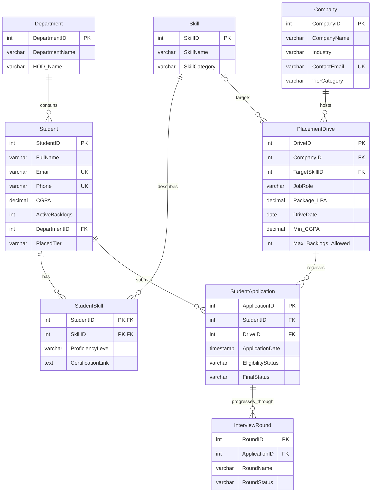
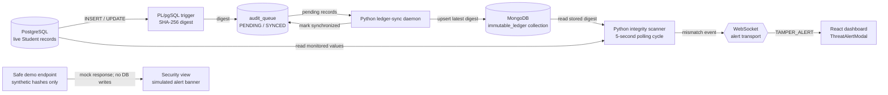

# Project Report: VeriPlace
## Advanced Placement Management System with CT-DIE Security

**Project:** VeriPlace — Placement Management and Data Integrity Monitoring  
**System type:** Web application with relational data management and a two-tier integrity-monitoring prototype  
**Primary users:** University placement-cell staff, students, and company-recruitment coordinators  
**Report status:** Describes the implementation in this repository, including its current safe security-demo behavior

---

## Abstract

VeriPlace is a web-based placement-management system for organizing student, company, recruitment-drive, application, and interview-round information. Its dashboard provides student and company management, drive eligibility screening, application tracking, and aggregate reports.

The system uses PostgreSQL as its operational relational database. A PostgreSQL trigger computes a SHA-256 digest from selected student fields and writes it to an audit queue. A Python daemon transfers queued digests to MongoDB, while a separate scanner compares the current PostgreSQL values against the stored ledger values and can send integrity-mismatch alerts to the dashboard over WebSocket.

The project demonstrates core database concepts—relational modeling, keys, constraints, joins, aggregation, and trigger-driven workflows—alongside a prototype integrity-monitoring architecture. The dashboard's manual **Simulate Danger** action is deliberately a safe demonstration: it generates synthetic mismatched hashes and does not modify database records. It must not be presented as a successful live database attack.

---

## 1. Introduction

### 1.1 Project Objective

The objective is to build a maintainable placement-management application backed by a relational database. It is intended to help a university placement cell centralize records, apply recruitment criteria consistently, follow candidates through recruitment rounds, and review placement activity through reports.

A secondary objective is to demonstrate how cryptographic hashes and a separate verification store can help identify unexpected changes to selected academic data.

### 1.2 Problem Statement

Placement activities often involve information spread across spreadsheets, emails, and manually updated records. This makes it difficult to:

- Maintain a consistent source of truth for student and company information.
- Apply company-specific eligibility rules consistently.
- Track applications and recruitment-round outcomes.
- Produce reliable department and company summaries.
- Detect unauthorized changes to sensitive academic fields such as CGPA and active backlogs.

VeriPlace addresses these needs with a central relational model and a browser-based dashboard. Its CT-DIE prototype explores integrity monitoring beyond ordinary application-layer validation by comparing selected live database values with separately stored digests.

### 1.3 Scope of the Project

The project includes the following functional modules:

1. **Student management:** List, create, update, and delete student records, including contact details, department, CGPA, active backlogs, and placement tier.
2. **Company management:** List, create, update, and delete company records with industry, contact email, and tier category.
3. **Placement-drive eligibility:** Select a drive and find students who meet its minimum CGPA and maximum-backlog limits, while excluding students already placed in the Dream tier.
4. **Application tracking:** Display applications with student, company, and final status information. Select multiple applications and update their status in a batch.
5. **Analytics and reports:** Summarize student and placement counts by department and applications and hires by company.
6. **Integrity-monitoring prototype:** Hash selected student fields in PostgreSQL, queue the digest, synchronize it to MongoDB, and compare it with a recalculated digest in a background scanner.
7. **Security dashboard demonstration:** Generate and display a clearly identified mock hash-mismatch alert without changing database data.

The current model does not implement authentication, role-based access control, email delivery, production-grade immutable/WORM storage, or predictive placement analytics. Those are possible future extensions, not current features.

### 1.4 Technology Stack

| Layer | Technology | Responsibility |
|---|---|---|
| Frontend | React.js | Dashboard components and interactive views |
| Styling | Tailwind CSS | Utility-based page styling |
| Frontend tooling | Vite | Development server and production bundling |
| Backend | FastAPI and Python | HTTP API and request handling |
| ASGI server | Uvicorn | Runs the FastAPI application |
| Tier 1 database | PostgreSQL | Operational relational records and integrity trigger |
| PostgreSQL extension | `pgcrypto` | SHA-256 digest generation |
| Tier 2 database | MongoDB | Stores the synchronized integrity digest |
| Background processes | Python daemons | Queue synchronization and integrity scanning |
| Alert transport | WebSocket | Sends scanner mismatch events to the dashboard |
| Infrastructure | Docker and Docker Compose | Builds and runs the application services |

---

## 2. Database Design & Architecture

### 2.1 Entity-Relationship (ER) Diagram

The diagram shows the principal entities and associative tables. `StudentSkill` resolves the many-to-many relationship between students and skills. `StudentApplication` connects students to placement drives, and each application may have interview rounds.



`audit_queue` is an additional operational table used by CT-DIE. It holds queued student digests and synchronization status. It is not a placement-domain entity and is therefore omitted from the ER diagram above.

### 2.2 Relational Schema Definition

| Relation | Primary key | Foreign keys and important constraints |
|---|---|---|
| `Department` | `DepartmentID` | `DepartmentName` is required |
| `Student` | `StudentID` | `DepartmentID` references `Department`; `Email` and `Phone` are unique and required |
| `Skill` | `SkillID` | Skill name and category |
| `StudentSkill` | (`StudentID`, `SkillID`) | Both columns reference their parent relations; deleting a student or skill cascades |
| `Company` | `CompanyID` | `ContactEmail` is unique when supplied |
| `PlacementDrive` | `DriveID` | `CompanyID` references `Company`; `TargetSkillID` references `Skill` and is set to `NULL` when that skill is deleted |
| `StudentApplication` | `ApplicationID` | `StudentID` references `Student`; `DriveID` references `PlacementDrive`; parent deletion cascades |
| `InterviewRound` | `RoundID` | `ApplicationID` references `StudentApplication`; application deletion cascades |
| `audit_queue` | `id` | Stores `student_id`, `record_hash`, and `sync_status`; the current DDL does not declare a foreign-key constraint on `student_id` |

Expanded schema examples:

```text
Department(DepartmentID [PK], DepartmentName, HOD_Name)
Student(StudentID [PK], FullName, Email [UNIQUE], Phone [UNIQUE],
        Tenth_Marks, Twelfth_Marks, CGPA, ActiveBacklogs, DeadBacklogs,
        ConsentStatus, PlacedTier, DepartmentID [FK])
Skill(SkillID [PK], SkillName, SkillCategory)
StudentSkill(StudentID [PK, FK], SkillID [PK, FK],
             ProficiencyLevel, CertificationLink)
Company(CompanyID [PK], CompanyName, Industry, ContactEmail [UNIQUE],
        TierCategory)
PlacementDrive(DriveID [PK], CompanyID [FK], JobRole, Package_LPA,
               DriveDate, Min_CGPA, Max_Backlogs_Allowed, TargetSkillID [FK])
StudentApplication(ApplicationID [PK], StudentID [FK], DriveID [FK],
                   ApplicationDate, EligibilityStatus, FinalStatus)
InterviewRound(RoundID [PK], ApplicationID [FK], RoundName, RoundStatus)
audit_queue(id [PK], student_id, record_hash, sync_status)
```

### 2.3 Normalization

The schema uses normalized relations to reduce duplication and make relationships explicit:

- **First Normal Form (1NF):** Each column stores a single value. For example, skills are not stored as a comma-separated list in `Student`; individual skills are represented by `Skill` and linked through `StudentSkill`.
- **Second Normal Form (2NF):** `StudentSkill` uses the composite key (`StudentID`, `SkillID`), and its descriptive fields (`ProficiencyLevel`, `CertificationLink`) describe that student-skill association rather than only one component of the key.
- **Third Normal Form (3NF):** Department attributes such as `HOD_Name` are stored with `Department`, not repeated for each student. Company details are stored in `Company`, while a drive references the company using `CompanyID`.

**Implementation note:** `StudentApplication` uses a surrogate primary key (`ApplicationID`). The current DDL does not enforce uniqueness on (`StudentID`, `DriveID`), so duplicate applications for the same student and drive are technically possible. Adding a unique constraint may be appropriate if the business rules require one application per student per drive.

### 2.4 Deployment Architecture

Docker Compose runs PostgreSQL, MongoDB, the backend API, the audit services, and the frontend as separate services. The React application sends HTTP requests to FastAPI. The CT-DIE scanner connects to the databases and publishes mismatch notifications through WebSocket.

---

## 3. Implementation of Database Concepts (with Queries)

### 3.1 Data Definition Language (DDL)

The following excerpt illustrates the student table's keys, required fields, and uniqueness constraints. The full definition is in [02_schema_placement.sql](./db-init/postgres/02_schema_placement.sql).

```sql
CREATE TABLE Student (
    StudentID SERIAL PRIMARY KEY,
    FullName VARCHAR(255) NOT NULL,
    Email VARCHAR(255) UNIQUE NOT NULL,
    Phone VARCHAR(20) UNIQUE NOT NULL,
    Tenth_Marks DECIMAL(5,2),
    Twelfth_Marks DECIMAL(5,2),
    CGPA DECIMAL(4,2) NOT NULL,
    ActiveBacklogs INT NOT NULL,
    DeadBacklogs INT DEFAULT 0,
    ConsentStatus BOOLEAN DEFAULT TRUE,
    PlacedTier VARCHAR(50),
    DepartmentID INT NOT NULL,
    FOREIGN KEY (DepartmentID) REFERENCES Department(DepartmentID)
);
```

`SERIAL` supplies generated identifiers. The foreign key ensures that each student references an existing department. The unique constraints prevent two records from sharing the same email address or phone number.

### 3.2 CRUD Operations (DML)

Representative parameterized operations follow. Example values are illustrative; they are not executed by this report.

**Insert a company**

```sql
INSERT INTO Company (CompanyName, Industry, ContactEmail, TierCategory)
VALUES ('TechCorp', 'IT/Software', 'placements@techcorp.example', 'Dream');
```

**Update a student's academic record**

```sql
UPDATE Student
SET CGPA = 8.50
WHERE StudentID = 1;
```

An update to the `Student` table also invokes the integrity trigger described in Section 4.

**Delete a placement drive**

```sql
DELETE FROM PlacementDrive
WHERE DriveID = 5;
```

The schema specifies cascading deletion from a company to its drives and from a drive to associated applications. Production systems should apply authorization and appropriate safeguards before destructive operations.

The application API uses parameterized query arguments for student and company writes, rather than constructing SQL from user-supplied text.

### 3.3 Complex Queries & Joins: Eligibility Engine

The backend verifies that the selected drive exists, then joins the drive to its company and filters students against the drive's CGPA and backlog criteria. The current implementation also excludes students already placed in the Dream tier.

```sql
SELECT
    s.StudentID,
    s.FullName,
    s.CGPA,
    s.ActiveBacklogs,
    s.PlacedTier,
    c.CompanyName
FROM Student AS s
JOIN PlacementDrive AS pd
  ON pd.DriveID = $1
JOIN Company AS c
  ON c.CompanyID = pd.CompanyID
WHERE s.CGPA >= pd.Min_CGPA
  AND s.ActiveBacklogs <= pd.Max_Backlogs_Allowed
  AND (s.PlacedTier IS NULL OR s.PlacedTier <> 'Dream')
ORDER BY s.CGPA DESC;
```

`$1` is a bound parameter supplied by the API. The current eligibility query does not filter candidates by `TargetSkillID` or `StudentSkill`; the drive's target skill is stored in the schema but is not currently part of this selection logic.

### 3.4 Aggregations & Grouping: Reporting

The department report preserves departments with no students by using a `LEFT JOIN`.

```sql
SELECT
    d.DepartmentName,
    COUNT(s.StudentID) AS TotalStudents,
    SUM(CASE WHEN s.PlacedTier IS NOT NULL THEN 1 ELSE 0 END) AS PlacedCount
FROM Department AS d
LEFT JOIN Student AS s
  ON s.DepartmentID = d.DepartmentID
GROUP BY d.DepartmentName
ORDER BY PlacedCount DESC;
```

The company conversion report joins companies to their drives and counts applications and hires:

```sql
SELECT
    c.CompanyName,
    COUNT(sa.ApplicationID) AS TotalApplications,
    SUM(CASE WHEN sa.FinalStatus = 'HIRED' THEN 1 ELSE 0 END) AS TotalHired
FROM Company AS c
JOIN PlacementDrive AS pd
  ON pd.CompanyID = c.CompanyID
LEFT JOIN StudentApplication AS sa
  ON sa.DriveID = pd.DriveID
GROUP BY c.CompanyName
ORDER BY TotalHired DESC, TotalApplications DESC;
```

### 3.5 Demo Data

The repeatable demo seed is stored in [05_seed_data.sql](./db-init/postgres/05_seed_data.sql). It inserts missing demo records without truncating existing application data. In the verified local environment, the database contained:

| Table | Demo rows |
|---|---:|
| Department | 50 |
| Student | 50 |
| Skill | 50 |
| StudentSkill | 100 |
| Company | 50 |
| PlacementDrive | 50 |
| StudentApplication | 100 |
| InterviewRound | 200 |
| `audit_queue` | 50 |

These counts describe the checked development database and may differ after users make changes.

---

## 4. Innovation Feature: CT-DIE
### Cryptographic Two-Tier Data Integrity Engine

### 4.1 The Security Threat (Insider Breach)

Application validation and permissions protect operations performed through the application, but they do not, by themselves, prove that stored data has remained unchanged if a privileged database operator or compromised administrative credential can write directly to the database.

CT-DIE's design objective is to provide an additional integrity signal: calculate a digest for selected student fields, keep a comparison copy in a separate database service, and periodically compare the current values with the stored digest. A mismatch can indicate that the monitored fields differ from the values last synchronized to the ledger.

This approach is a monitoring prototype, not a complete security boundary. In particular, a digest does not establish who made a change, prevent a database administrator from changing data, or guarantee immutability if both services or their credentials are compromised.

### 4.2 How CT-DIE Works

1. **Trigger phase:** A PostgreSQL `AFTER INSERT OR UPDATE` trigger on `Student` runs the integrity-hash function.
2. **Hashing phase:** The function concatenates `StudentID`, `CGPA`, and `ActiveBacklogs`, then computes a SHA-256 digest with `pgcrypto`.
3. **Queue phase:** The digest is written to `audit_queue` with a `PENDING` synchronization status.
4. **Synchronization phase:** The Python ledger-sync daemon polls pending queue entries, writes the latest digest for each student to the MongoDB `immutable_ledger` collection, then marks the queue row as synchronized.
5. **Scanning phase:** The integrity scanner polls student rows, recomputes the digest, and compares it with the MongoDB entry.
6. **Alert phase:** When the scanner detects a mismatch and a dashboard WebSocket client is connected, it broadcasts a `TAMPER_ALERT` payload. The frontend's alert component can display a warning modal.

**Important implementation qualification:** The collection is named `immutable_ledger`, but the current synchronizer uses an upsert that replaces the stored hash for a student. It is therefore a separate comparison store in this prototype, not a technically append-only or tamper-proof ledger. A production implementation would need stronger access isolation, append-only retention, key management, authenticated service communication, and independently monitored backups.

### 4.3 System Architecture Diagram for CT-DIE



### 4.4 Attack Simulation & Detection

The requested outline describes a demonstration in which a privileged actor bypasses normal application workflows, changes monitored data, and attempts to evade trigger-based auditing. That is a threat scenario the integrity scanner is intended to help identify; the report does not provide or execute instructions for bypassing database protections.

**The current application does not perform that attack.** The `/api/simulator/simulate-breach` endpoint returns two deterministic synthetic hashes and a `simulation: true` response. The Security view displays a red **SIMULATED INTEGRITY ALERT** banner and explicitly states that no database records were changed. This replaced the earlier database-changing behavior with a harmless UI demonstration. The database values were checked before and after the demo call and remained unchanged.

The actual scanner path is separate: it compares the live student digest with the MongoDB digest and can send a WebSocket `TAMPER_ALERT` if the values differ. The manual safe-demo button does not trigger this scanner path and does not prove that a real database tampering event has been detected.

**Screenshot placeholder:** Insert a screenshot of the dashboard's **SIMULATED INTEGRITY ALERT** banner here. Label it “Safe UI simulation; no database records were modified.” Do not caption it as evidence of a real breach or scanner detection.

---

## 5. Frontend UI & System Output

The React dashboard is served by Vite and presents the placement workflows as navigable views.

### 5.1 Student and Company Management

The Student view presents a student registration form and a table with student identifiers, names, CGPA, active backlogs, placement tier, and edit/delete actions. The Company view presents company information and the corresponding management table.

**Screenshot placeholder — Student CRUD:** Insert a screenshot showing the populated student table and registration form.

**Screenshot placeholder — Company CRUD:** Insert a screenshot showing the company table and company form.

### 5.2 Automated Eligibility Engine

The Eligibility view accepts a placement-drive ID and shows candidates who satisfy that drive's CGPA and backlog cutoffs and are not already in the Dream tier. A result includes the student, CGPA, placement tier, and target company.

**Screenshot placeholder — Eligibility results:** Insert a screenshot after running the engine for a populated drive.

### 5.3 Application Tracker

The Tracker view loads application rows from the backend, including the application ID, student name, company, and final status. It supports selecting multiple rows and submitting a batch status update.

**Screenshot placeholder — Application tracker:** Insert a screenshot showing populated applications and their statuses.

### 5.4 Analytics Dashboard

The Analytics view displays department student/placement counts and company application/hire counts. It uses backend aggregation queries rather than browser-only sample rows.

**Screenshot placeholder — Analytics:** Insert a screenshot showing both department and company report tables.

### 5.5 Security Operations Center

The Security view contains a synchronization-feed presentation, explanatory text, and the safe **SIMULATE DANGER (SAFE DEMO)** button. Clicking the button displays generated sample hashes with an explicit notice that no database changes occurred. The scrolling feed currently generates sample hash strings in the browser; it is not a live stream of MongoDB synchronization events. The separate WebSocket alert component is intended to display scanner-originated mismatch notifications.

**Screenshot placeholder — SOC:** Insert a screenshot showing the dark Security Operations Center and its feed.

**Screenshot placeholder — Demo alert:** Insert a screenshot of the safe simulated alert banner. Do not represent it as a real scanner alert.

---

## 6. Conclusion & Future Scope

### 6.1 Conclusion

VeriPlace demonstrates how relational database concepts can support a practical placement workflow. The project models core entities and their relationships, uses primary and foreign keys to maintain referential integrity, performs parameterized CRUD operations, applies eligibility rules with joins and filters, and produces aggregate reports with grouping.

The CT-DIE prototype adds a trigger-driven hashing and cross-database comparison workflow to the placement system. It illustrates how independently stored integrity references and periodic verification can provide an additional signal when monitored data changes. The current safe Security button is intentionally a mock demonstration; actual integrity detection depends on the separate scanner and ledger path.

### 6.2 Future Enhancements

- **Production-grade ledger:** Use append-only records, restricted write permissions, independent retention, and tamper-evident audit controls instead of replacing one current hash per student.
- **Authentication and authorization:** Add identity management and role-based permissions for students, placement staff, and administrators.
- **Audit attribution:** Record actor identity, change time, and authorized reason for every sensitive update.
- **Data validation:** Add database checks for valid CGPA ranges, nonnegative backlog counts, allowed status values, and uniqueness rules such as one application per student per drive.
- **Eligibility improvements:** Include required-skill matching and configurable institutional rules in the eligibility query.
- **Reliable alerting:** Add alert deduplication, delivery status, reconnect/backoff handling, and persistent incident history.
- **Placement prediction:** Explore machine-learning models for placement trends only after defining appropriate privacy, consent, validation, and fairness controls.
- **Student notifications:** Integrate an SMTP or transactional email service for application and interview updates.
- **Testing and operations:** Add automated integration tests, database migrations, health checks, backups, and production deployment configuration.

---

## 7. References

1. PostgreSQL Global Development Group. *PostgreSQL Documentation — Triggers*. <https://www.postgresql.org/docs/current/triggers.html>
2. PostgreSQL Global Development Group. *PostgreSQL Documentation — `pgcrypto`*. <https://www.postgresql.org/docs/current/pgcrypto.html>
3. PostgreSQL Global Development Group. *PostgreSQL Documentation — Constraints*. <https://www.postgresql.org/docs/current/ddl-constraints.html>
4. FastAPI. *FastAPI Documentation*. <https://fastapi.tiangolo.com/>
5. React. *React Documentation*. <https://react.dev/>
6. Vite. *Vite Documentation*. <https://vite.dev/guide/>
7. Tailwind CSS. *Tailwind CSS Documentation*. <https://tailwindcss.com/docs>
8. Docker. *Docker Compose Documentation*. <https://docs.docker.com/compose/>
9. MongoDB. *MongoDB Manual*. <https://www.mongodb.com/docs/manual/>

---

## Appendix A: Implementation Files

| Area | Project file |
|---|---|
| Relational schema | [02_schema_placement.sql](./db-init/postgres/02_schema_placement.sql) |
| Audit queue | [03_audit_queue.sql](./db-init/postgres/03_audit_queue.sql) |
| Hash function and trigger | [04_crypto_triggers.sql](./db-init/postgres/04_crypto_triggers.sql) |
| Repeatable demo seed | [05_seed_data.sql](./db-init/postgres/05_seed_data.sql) |
| Placement and eligibility API | [placement_routes.py](./backend-api/routers/placement_routes.py) |
| Application tracking API | [application_routes.py](./backend-api/routers/application_routes.py) |
| Reporting API | [report_routes.py](./backend-api/routers/report_routes.py) |
| Safe alert simulation | [attack_simulator.py](./backend-api/routers/attack_simulator.py) |
| Ledger synchronization daemon | [ledger_sync.py](./audit-daemon/ledger_sync.py) |
| Integrity scanner and WebSocket | [integrity_scanner.py](./audit-daemon/integrity_scanner.py) |
| Dashboard | [App.jsx](./frontend-dashboard/src/App.jsx) |
